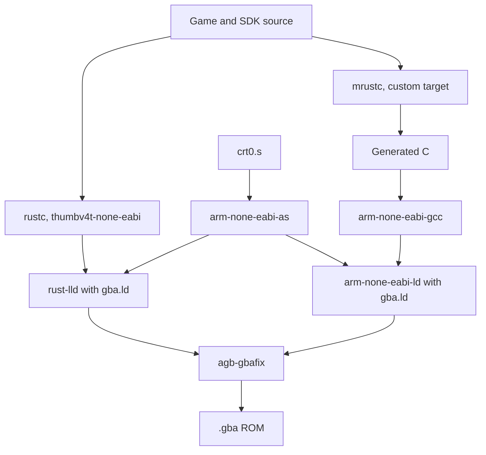

# Backends

gba-sdk compiles the same source through two backends. One exists.

| Backend | Pipeline | Status |
| --- | --- | --- |
| native | `rustc` (LLVM) for `thumbv4t-none-eabi` | Builds and boots. The reference: every feature works here first. |
| mrustc | `mrustc` to C, then `arm-none-eabi-gcc` | Planned. Starts with a spike that builds `core` and the hello ROM. |

Both share the assembler, the linker script (though not the linker), the startup code and `agb-gbafix`, so a ROM from either backend has the same layout. Only the Rust half differs.

The linkers differ: the native backend uses `rust-lld`, the target's default, and mrustc will link through GCC's `arm-none-eabi-ld`. Both read the same `gba.ld`.

## Native

`cargo build --target thumbv4t-none-eabi` with `-Zbuild-std=core`, since the target is Tier 3 and ships no prebuilt `core`. `gba/.cargo/config.toml` adds `-Ctarget-cpu=arm7tdmi`, the linker script and the assembled `crt0.o` to the link. `just gba::rom` wraps all of it.

## mrustc

[mrustc](https://github.com/thepowersgang/mrustc) is a Rust compiler written in C++ that emits C and hands it to GCC. The point of supporting it is GCC's code generation (the established toolchain for GBA games) and a build with no LLVM in it. It is a second backend, not a C port: its output is generated code nobody maintains.

mrustc assumes its input is valid Rust and has no borrow checker, so `rustc` checks every build first, and a disagreement between the backends is a bug on the mrustc side until shown otherwise. The constraints it puts on the SDK's code are listed in [`gba/AGENTS.md`](https://github.com/rusty-console-sdk/sdk/blob/main/gba/AGENTS.md): Rust 1.90 as the language floor, assembly only in `.s` files, `extern "C"` at every ABI boundary, no proc macros or build scripts in ROM crates, no compare-and-swap atomics.

## What works where

| Feature | native | mrustc |
| --- | --- | --- |
| Boot, `entry!` | yes | planned |
| Mode 3, buttons | yes | planned |
| `log!`, panics | yes | planned |
| Code in IWRAM | yes, through `.iwram` sections | planned; mrustc's C backend may drop `#[link_section]` on functions, so a test will check the addresses |

A feature that only works on one backend gets a row here with the reason, not a silent omission.
